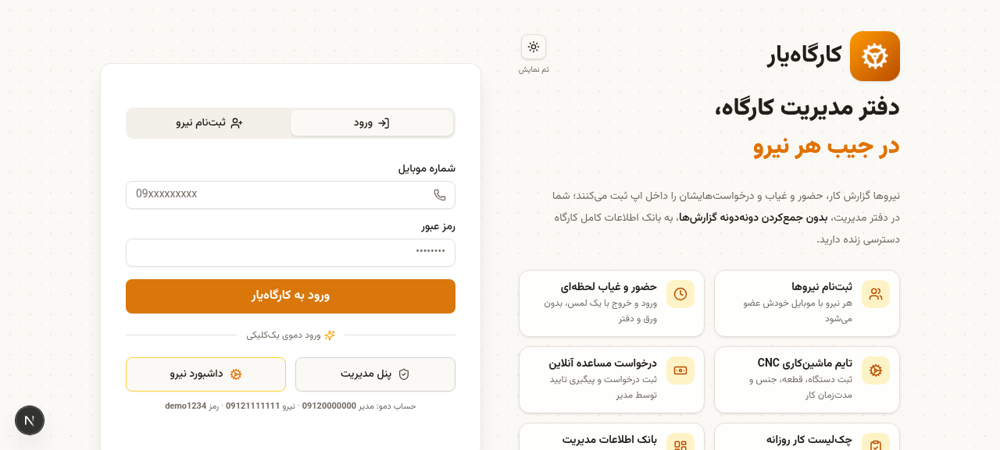
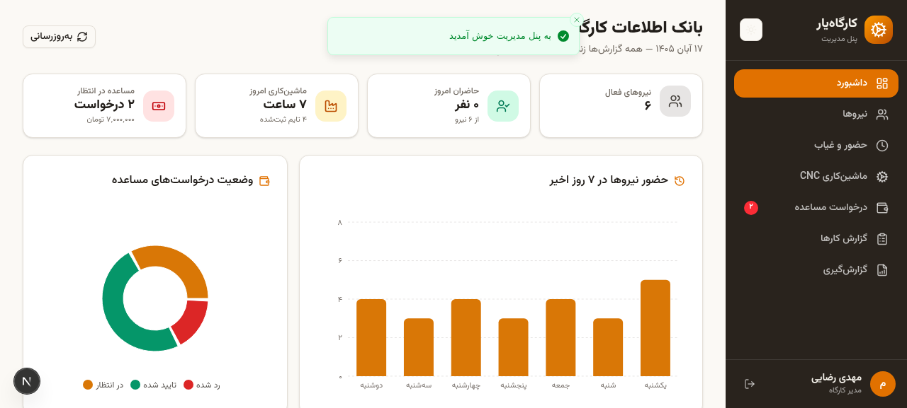
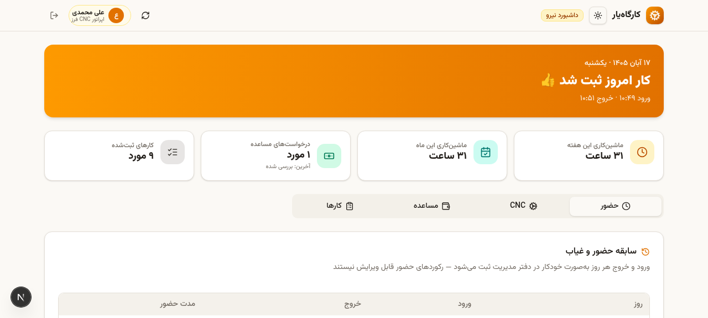

# ⚙️ کارگاه‌یار — سامانه مدیریت کارگاه صنعتی

<div dir="rtl">

**کارگاه‌یار** یک اپلیکیشن تحت وب و دسکتاپ برای مدیریت هوشمند کارگاه‌های صنعتی کوچک و متوسط است؛ نیروهای کارگاه به‌صورت خودثبت، حضور و غیاب، تایم ماشین‌کاری CNC، درخواست مساعده و کارهای روزانه خود را ثبت می‌کنند و مدیریت **بدون جمع‌آوری گزارش‌های تکی**، به کل بانک اطلاعات به‌صورت زنده دسترسی دارد.

| صفحه ورود | داشبورد مدیریت |
| --- | --- |
|  |  |
| **پنل نیرو** | |
|  | |

</div>

---

## ✨ امکانات

<div dir="rtl">

### 👷 پنل نیرو (کارگر / اپراتور)
- **حضور و غیاب**: ثبت ورود و خروج با تاییدیه هوشمند هنگام خروج (جلوگیری از ثبت اشتباهی) + تاریخچه شیفت‌ها با محاسبه خودکار مدت حضور (پشتیبانی از چند شیفت در روز)
- **ماشین‌کاری CNC**: ثبت تایم ماشین‌کاری هر قطعه (دستگاه، قطعه، جنس، ساعت شروع/پایان) با محاسبه خودکار مدت — **و امکان ویرایش** رکوردها در صورت اشتباه
- **درخواست مساعده**: ثبت درخواست با مبلغ و دلیل + پیگیری وضعیت (در انتظار / تایید / رد) و پاسخ مدیریت
- **گزارش کار روزانه**: چک‌لیست کارهای انجام‌شده با دسته‌بندی (عمومی، تعمیرات، کنترل کیفیت، بسته‌بندی، ایمنی) + ویرایش
- **سه تم نمایشی**: روشن، تاریک و خاکستری (کم‌آزار چشم) — قابل انتخاب کنار اسم «کارگاه‌یار»

### 🧑‍💼 پنل مدیریت (دفتر کارگاه)
- **داشبورد زنده**: نیروهای حاضر، تایم امروز دستگاه‌ها، نمودارهای هفتگی، وضعیت مساعده‌ها و **فید «فعالیت‌های اخیر کارگاه» با فیلتر روز و ماه شمسی**
- **نیروها**: مشاهده خلاصه وضعیت هر نیرو + **افزودن، ویرایش و حذف نیرو**
- **حضور و غیاب**: بانک کامل ورود/خروج همه نیروها با **فیلتر روز و ماه شمسی**
- **ماشین‌کاری CNC**: تایم تمام قطعات به تفکیک دستگاه و نیرو
- **درخواست مساعده**: بررسی، تایید یا رد درخواست‌ها با یادداشت
- **گزارش کارها**: چک‌لیست کارهای همه نیروها
- **گزارش‌گیری**: انتخاب نوع داده (حضور و غیاب، CNC، مساعده، کارها) + بازه شمسی و نیرو → خروجی **اکسل (xlsx)**، **CSV** و **چاپ / PDF**

### 🔐 سایر
- ثبت‌نام خود نیرو با شماره موبایل (اعتبارسنجی ایرانی `09xxxxxxxxx`)
- رابط کاملاً فارسی، راست‌به‌چپ و ریسپانسیو (موبایل / تبلت / دسکتاپ) با فونت وزیرمتن و تقویم شمسی

</div>

---

## 🖥️ نصب نسخه ویندوز (exe)

<div dir="rtl">

1. به بخش [Releases](../../releases/latest) بروید و فایل `Kargahyar-Setup-1.0.0.exe` را دانلود کنید.
2. فایل را اجرا کنید — نصب به‌صورت خودکار انجام می‌شود و میان‌بری روی دسکتاپ ساخته می‌شود.
3. برنامه کاملاً **آفلاین** اجرا می‌شود؛ دیتابیس به‌صورت محلی در پروفایل کاربری ویندوز ذخیره می‌شود (`%APPDATA%\Kargahyar\kargahyar.db`).

### حساب‌های دمو (پیش‌فرض)

| نقش | شماره موبایل | رمز |
| --- | --- | --- |
| مدیر | `09120000000` | `demo1234` |
| نیرو ۱ | `09121111111` | `demo1234` |
| نیرو ۲ | `09122222222` | `demo1234` |
| نیرو ۳ | `09123333333` | `demo1234` |
| نیرو ۴ | `09124444444` | `demo1234` |

</div>

---

## 🛠 اجرای محلی (نسخه وب)

<div dir="rtl">

پیش‌نیاز: [Bun](https://bun.sh) (یا Node.js 20+)

```bash
bun install

# تنظیم دیتابیس
echo 'DATABASE_URL=file:'"$(pwd)"'/db/custom.db' > .env
bunx prisma db push

# داده نمونه دمو (اختیاری)
bun prisma/seed.ts

# حالت توسعه
bun run dev

# نسخه پروداکشن
bun run build
bun run start
```

</div>

## 📦 ساخت مجدد نسخه ویندوز

<div dir="rtl">

اسکریپت آماده در `scripts/build-desktop.sh` مسیر کامل بیلد را انجام می‌دهد:
بیلد standalone بعد + کپی موتور Prisma ویندوز + ساخت seed دیتابیس + نصب Electron و خروجی NSIS.

ساختار پوشه `desktop/` شامل پروسه اصلی Electron (`main.js`) و تنظیمات `electron-builder` است.

</div>

## 🏗 معماری

<div dir="rtl">

- **Frontend**: Next.js 16 (App Router) + TypeScript + Tailwind CSS 4 + shadcn/ui + Recharts
- **Backend**: Route Handlers با Prisma ORM
- **Database**: SQLite (قابل ارتقا به PostgreSQL/MySQL)
- **Desktop**: Electron + خروجی NSIS (نصب‌کننده ویندوز)
- تقویم و اعداد: شمسی (`Intl` با `fa-IR`)

```
src/
├── app/api/          ← APIها (auth، worker، admin)
├── components/app/   ← صفحات و کامپوننت‌های اپ
└── lib/              ← کلاینت دیتابیس، تقویم شمسی، خروجی گزارش
desktop/              ← پوسته Electron ویندوز
prisma/               ← اسکیما و seed دمو
```

</div>

## 📄 لایسنس

MIT — برای جزئیات [LICENSE](LICENSE) را ببینید.
